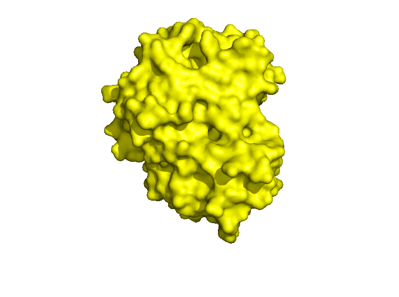

[](https://badge.fury.io/py/py-packman)
[](https://github.com/Pranavkhade/PACKMAN/actions/workflows/python-package.yml)
[](https://py-packman.readthedocs.io/en/latest/)

<p align="center">
  
</p>

# PACKMAN

PACKMAN (PACKing and Motion ANalysis) is a Python toolkit for protein
structure, packing, and motion analysis. It includes PDB/mmCIF structure tools,
hinge prediction, ANM/hdANM, GNM, packing entropy, and dynamic community
identification.

## Install

```console
python -m pip install py-packman
```

## Use PACKMAN

- **Python:** follow the [quickstart](https://py-packman.readthedocs.io/en/latest/quickstart.html).
- **Command line:** run `python -m packman --help`.
- **Desktop GUI:** run `python -m packman gui`.
- **Browser app:** see the [Streamlit guide](https://py-packman.readthedocs.io/en/latest/tutorials/streamlit.html)
  for hinge prediction, hdANM, packing entropy, and Docker instructions.

## Documentation and support

Browse the [documentation](https://py-packman.readthedocs.io/en/latest/),
[API map](https://py-packman.readthedocs.io/en/latest/api-map.html), or report
an issue in the [GitHub issue tracker](https://github.com/Pranavkhade/PACKMAN/issues).

## Web servers

- [Hinge prediction](https://packman.bb.iastate.edu/)
- [hdANM](https://hdanm.bb.iastate.edu/)
- [Packing entropy](https://packing-entropy.bb.iastate.edu/)
- [Dynamic community identification (DCI)](https://dci.bb.iastate.edu/)

## Related research articles

- [PACKMAN-molecule](https://doi.org/10.1093/bioadv/vbac007)
- [Hinge prediction](https://doi.org/10.1016/j.jmb.2019.11.018)
- [Structural compliance](https://doi.org/10.1002/prot.25968)
- [hdANM](https://doi.org/10.1016/j.bpj.2021.10.017)
- [Packing entropy](https://doi.org/10.1021/acsomega.2c00999)
- [DCI](https://doi.org/10.1093/bioinformatics/btac159)

## Acknowledgements

PACKMAN was developed from 2017 to 2022. NSF grant DBI-1661391 continues to
support the web servers. The authors thank
[ResearchIT@Iowa State University](https://researchit.las.iastate.edu/about-research-it-iowa-state-university)
for assistance with server deployment. Development since April 2022 has
proceeded without financial or other support.

See [LICENSE](LICENSE) for license terms.
