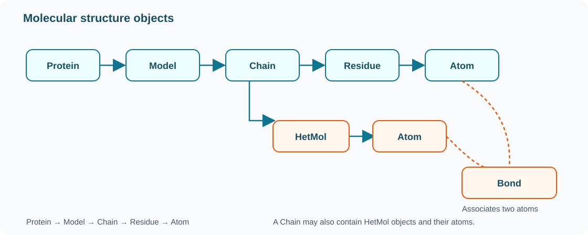

.. _api-map:

PACKMAN API map
===============

Use this page as a structured alternative to the alphabetical
:ref:`genindex`. The object diagram shows how parsed structures are organized;
the API groups link to the public classes and functions, while the package
reference contains their complete method documentation.

Molecular object hierarchy
--------------------------

The hierarchy can also be read as a text tree:

.. code-block:: text

   Protein
   `-- Model (one frame)
       `-- Chain
           |-- Residue
           |   `-- Atom
           `-- HetMol
               `-- Atom

   Bond connects a pair of atoms.

Structure objects and I/O
-------------------------

.. autosummary::
   :nosignatures:

   packman.molecule.Protein
   packman.molecule.Model
   packman.molecule.Chain
   packman.molecule.Residue
   packman.molecule.Atom
   packman.molecule.HetMol
   packman.molecule.Bond
   packman.molecule.Hinge
   packman.molecule.load_structure
   packman.molecule.download_structure
   packman.molecule.molecule.batch_download

Modeling and analysis objects
-----------------------------

.. autosummary::
   :nosignatures:

   packman.anm.ANM
   packman.anm.hdANM
   packman.gnm.GNM
   packman.entropy.PackingEntropy
   packman.apps.DCI

Geometry and utility functions
------------------------------

.. autosummary::
   :nosignatures:

   packman.geometry.Circumsphere
   packman.geometry.AlphaShape
   packman.utilities.superimporse
   packman.utilities.RMSD
   packman.utilities.load_hinge
   packman.utilities.WriteOBJ
   packman.utilities.change_alphabet

Applications and command-line entry points
-------------------------------------------

.. autosummary::
   :nosignatures:

   packman.apps.predict_hinge
   packman.apps.hinge_cli
   packman.apps.hdanm_cli
   packman.apps.entropy_cli
   packman.apps.dci_cli

Browse the full reference by package:

.. toctree::
   :maxdepth: 2

   modules

The generated reference documents each class's methods. For a quick
alphabetical lookup, see the :ref:`genindex`.
